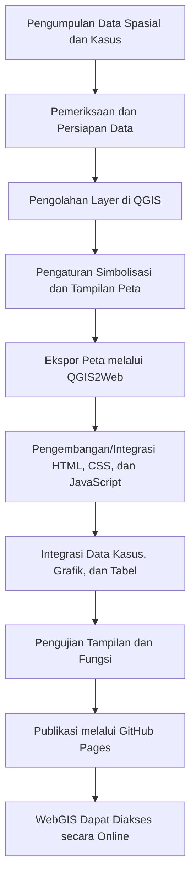

<div align="center">

# WebGIS Dinamika Penyakit Menular Kota Semarang

**Pemetaan Persebaran Kasus Penyakit Menular dan Informasi Aksesibilitas Fasilitas Kesehatan**

[](https://arvaakhadi.github.io/WebGIS-Penyakit-Menular/)
[](https://pages.github.com/)
[](https://qgis.org/)
[](https://leafletjs.com/)

</div>

---

## Daftar Isi

- [1. Tentang Proyek](#1-tentang-proyek)
- [2. Tujuan](#2-tujuan)
- [3. Cakupan Informasi](#3-cakupan-informasi)
- [4. Fitur WebGIS](#4-fitur-webgis)
- [5. Data dan Sumber Data](#5-data-dan-sumber-data)
- [6. Teknologi yang Digunakan](#6-teknologi-yang-digunakan)
- [7. Alur Pengembangan](#7-alur-pengembangan)
- [8. Struktur Repositori](#8-struktur-repositori)
- [9. Cara Mengakses dan Menggunakan](#9-cara-mengakses-dan-menggunakan)
- [10. Menjalankan Secara Lokal](#10-menjalankan-secara-lokal)
- [11. Publikasi](#11-publikasi)
- [12. Catatan dan Keterbatasan](#12-catatan-dan-keterbatasan)
- [13. Pengembang](#13-pengembang)
- [14. Referensi Teknologi](#14-referensi-teknologi)

---

## 1. Tentang Proyek

WebGIS Dinamika Penyakit Menular Kota Semarang merupakan aplikasi pemetaan berbasis web untuk menampilkan informasi persebaran kasus **Leptospirosis, Tuberkulosis (TB) Baru, dan Demam Berdarah Dengue (DBD)**, serta informasi spasial mengenai aksesibilitas fasilitas kesehatan.

Aplikasi menggabungkan peta interaktif dengan ringkasan statistik, grafik kasus bulanan, dan tabel data kasus. Pengguna dapat memilih jenis penyakit dan tahun untuk melihat informasi yang tersedia pada aplikasi.

Peta dipublikasikan melalui GitHub Pages dan dapat diakses melalui tautan berikut:

**[Buka WebGIS Dinamika Penyakit Menular Kota Semarang](https://arvaakhadi.github.io/WebGIS-Penyakit-Menular/)**

### Tampilan Aplikasi

> **Tambahkan screenshot aktual sebelum README dipublikasikan.** Simpan gambar halaman utama di `docs/images/tampilan-utama.png`, lalu aktifkan baris gambar di bawah dengan menghapus tanda komentar HTML.

<!--
<p align="center">
  
</p>
-->

## 2. Tujuan

Pengembangan WebGIS ini bertujuan untuk:

1. Menyajikan informasi persebaran kasus penyakit menular di Kota Semarang dalam bentuk peta interaktif.
2. Mempermudah penelusuran informasi kasus berdasarkan jenis penyakit dan tahun yang tersedia.
3. Mengintegrasikan visualisasi peta dengan ringkasan statistik, grafik, dan tabel data.
4. Menampilkan informasi spasial mengenai kategori aksesibilitas fasilitas kesehatan.
5. Mendokumentasikan data, teknologi, dan cara penggunaan aplikasi untuk mendukung evaluasi serta pengembangan selanjutnya.

## 3. Cakupan Informasi

### 3.1 Wilayah Kajian

Wilayah kajian aplikasi adalah Kota Semarang, Provinsi Jawa Tengah, Indonesia.

### 3.2 Jenis Penyakit

Aplikasi menyediakan pilihan tiga jenis penyakit:

- **Leptospirosis**
- **TB Baru**
- **Demam Berdarah Dengue (DBD)**

### 3.3 Periode Data

Pilihan tahun yang tersedia pada antarmuka adalah **2019–2026**. Kelengkapan data dapat berbeda antartahun dan antarjenis penyakit. Data tahun 2026 perlu diperlakukan sebagai data yang mungkin belum mencakup satu tahun penuh; periksa periode pembaruan sumber sebelum membandingkannya dengan tahun sebelumnya.

### 3.4 Informasi Aksesibilitas Fasilitas Kesehatan

Repositori juga memuat layer fasilitas kesehatan dan kategori aksesibilitas yang ditampilkan sebagai:

- Rumah Sakit
- Sangat Terjangkau
- Terjangkau
- Jauh
- Tidak Terjangkau

**Catatan:** definisi kategori, metode penentuan keterjangkauan, satuan jarak/waktu, dan sumber data layer aksesibilitas perlu dijelaskan berdasarkan metode pengolahan yang digunakan pada proyek. Jangan menafsirkan nama kategori sebagai ukuran jarak tertentu sebelum metodenya dipastikan.

## 4. Fitur WebGIS

Fitur berikut diidentifikasi dari struktur HTML, JavaScript, dan data yang disertakan dalam repositori.

| Fitur | Fungsi |
|---|---|
| Pemilihan jenis penyakit | Memilih Leptospirosis, TB Baru, atau DBD. |
| Pemilihan tahun | Menampilkan data untuk tahun yang tersedia pada pilihan 2019–2026. |
| Peta persebaran kasus | Menyajikan jumlah kasus menurut wilayah kerja Puskesmas melalui simbolisasi pada peta. |
| Legenda peta | Membantu membaca kategori warna berdasarkan jumlah kasus yang ditampilkan. |
| Ringkasan statistik | Menampilkan indikator total kasus dan kasus aktif sesuai perhitungan aplikasi. Definisi indikator perlu mengacu pada implementasi dan sumber data. |
| Grafik kasus bulanan | Menampilkan seri data kasus bulanan yang tersedia untuk penyakit dan tahun terpilih. |
| Tabel data kasus | Menyajikan nama Puskesmas, kasus laki-laki, kasus perempuan, total kasus, dan jumlah kematian. |
| Layer aksesibilitas fasilitas kesehatan | Menampilkan layer Rumah Sakit dan kategori aksesibilitas yang tersedia pada peta. |
| Basemap citra satelit | Memberikan konteks visual geografis pada peta. |
| Navigasi halaman | Menyediakan bagian peta/statistik, data kasus, dan informasi tentang WebGIS. |

### Contoh Dokumentasi Screenshot

Untuk melengkapi dokumentasi tugas, disarankan menambahkan screenshot aktual untuk:

1. Halaman utama yang memperlihatkan peta dan panel ringkasan.
2. Peta setelah jenis penyakit dan tahun dipilih.
3. Grafik kasus bulanan.
4. Halaman tabel data kasus.
5. Layer aksesibilitas fasilitas kesehatan.
6. Halaman “Tentang WebGIS”.

Simpan screenshot yang dipilih di `docs/images/`, kemudian tambahkan gambar dengan format Markdown, misalnya:

```markdown

```

## 5. Data dan Sumber Data

Aplikasi menggunakan berkas data lokal yang disertakan dalam repositori. Berdasarkan struktur folder, data mencakup geometri wilayah kerja Puskesmas, data kasus per penyakit dan tahun, serta layer fasilitas kesehatan dan aksesibilitas.

| Data | Berkas/lokasi di repositori | Keterangan |
|---|---|---|
| Geometri wilayah kerja Puskesmas | `data/puskesmas.geojson` | GeoJSON yang memuat geometri dan atribut Puskesmas. |
| Data peta kasus | `data/leptospirosis/`, `data/tb_baru/`, `data/dbd/` | Berkas JSON per tahun untuk visualisasi peta. |
| Data grafik dan tabel | Folder penyakit yang sama | Berkas JSON untuk data grafik dan tabel berdasarkan tahun. |
| Layer aksesibilitas dan fasilitas kesehatan | `data/TidakTerjangkau_1.js`, `data/Jauh_2.js`, `data/Terjangkau_3.js`, `data/SangatTerjangkau_4.js`, `data/RumahSakit_5.js` | Data layer yang dimuat oleh aplikasi peta. |

### 5.1 Sumber Data Kasus

Pada kode aplikasi dan metadata berkas, terdapat rujukan ke **Dashboard Kesehatan Kota Semarang / LEKMINkes Dinas Kesehatan Kota Semarang**. Beberapa metadata data juga mencantumkan label sumber seperti **HEWS** untuk DBD dan **Gismap/Leptospirosis** untuk Leptospirosis.

- Dashboard yang ditautkan aplikasi: [LEKMINkes Dinas Kesehatan Kota Semarang](https://lekminkes.dinkes.semarangkota.go.id/)
- Label sumber pada metadata DBD: HEWS.
- Label sumber pada metadata Leptospirosis: Gismap/Leptospirosis.
- **Sumber spesifik data TB Baru, data batas wilayah Puskesmas, serta layer aksesibilitas: perlu dikonfirmasi dari sumber data asli.**

Sebelum penyerahan akhir, pastikan sumber, tanggal akses, periode, dan cara pengambilan setiap dataset dicantumkan dengan benar. Keberadaan tautan pada aplikasi tidak dengan sendirinya membuktikan bahwa semua dataset berasal dari sumber yang sama.

## 6. Teknologi yang Digunakan

| Teknologi | Peran dalam aplikasi |
|---|---|
| **QGIS** | Pengolahan data spasial, pengaturan layer, dan simbolisasi peta. |
| **QGIS2Web** | Membantu mengekspor proyek peta QGIS menjadi aplikasi peta web. |
| **HTML** | Menyusun struktur halaman dan komponen antarmuka. |
| **CSS** | Mengatur tata letak dan tampilan aplikasi. |
| **JavaScript** | Menjalankan interaksi peta, memuat data, dan memperbarui tampilan. |
| **Leaflet** | Menampilkan peta web interaktif dan layer geografis. |
| **Chart.js** | Membuat grafik kasus bulanan. |
| **Turf.js** | Library analisis geospasial JavaScript yang direferensikan oleh halaman aplikasi. |
| **GitHub Pages** | Memublikasikan aplikasi sebagai situs web statis. |

Aplikasi menggunakan berkas hasil ekspor QGIS2Web/Leaflet dan kode HTML, CSS, serta JavaScript tambahan untuk menyajikan panel statistik, grafik, tabel, dan pilihan penyakit/tahun.

**Basemap:** kode aplikasi merujuk pada tile citra satelit Google. Pastikan penggunaan basemap mengikuti ketentuan layanan dan atribusi dari penyedianya.

## 7. Alur Pengembangan

Alur umum pengembangan berdasarkan struktur proyek adalah sebagai berikut:



Tahapan rinci perlu disesuaikan dengan proses yang benar-benar dilakukan. Diagram ini menggambarkan alur umum, bukan catatan otomatis seluruh aktivitas pengembangan.

## 8. Struktur Repositori

Struktur utama yang ditemukan pada ZIP repositori adalah:

```text
WebGIS-Penyakit-Menular/
├── index.html
├── README.txt
├── scraper_semarang.py
├── css/
│   ├── leaflet.css
│   ├── qgis2web.css
│   ├── leaflet-measure.css
│   └── ...
├── data/
│   ├── puskesmas.geojson
│   ├── Jauh_2.js
│   ├── RumahSakit_5.js
│   ├── SangatTerjangkau_4.js
│   ├── Terjangkau_3.js
│   ├── TidakTerjangkau_1.js
│   ├── dbd/
│   │   ├── map_2019.json
│   │   ├── bar_2019.json
│   │   ├── line_2019.json
│   │   └── ...
│   ├── leptospirosis/
│   │   └── ...
│   └── tb_baru/
│       └── ...
├── js/
│   ├── leaflet.js
│   ├── qgis2web_expressions.js
│   ├── leaflet-measure.js
│   └── ...
└── webfonts/
    └── ...
```

### Penjelasan berkas utama

- **`index.html`** — halaman utama yang mengatur antarmuka, peta, pilihan penyakit/tahun, statistik, grafik, dan tabel.
- **`css/`** — stylesheet untuk peta, kontrol, ikon, dan tata letak.
- **`js/`** — library dan skrip JavaScript yang mendukung peta dan interaksi.
- **`data/puskesmas.geojson`** — geometri dan atribut wilayah kerja Puskesmas.
- **`data/dbd/`, `data/leptospirosis/`, `data/tb_baru/`** — data JSON yang digunakan untuk peta, grafik, dan tabel kasus per tahun.
- **Berkas `data/*_*.js`** — layer geografis untuk fasilitas kesehatan dan kategori aksesibilitas.
- **`scraper_semarang.py`** — skrip Python untuk mengambil dan menyiapkan data dari layanan sumber. Tinjau keamanan dan kelayakan distribusinya sebelum dipertahankan di repositori publik.
- **`webfonts/`** — berkas font yang digunakan oleh komponen antarmuka.

Nama dan isi berkas di atas mengikuti ZIP yang diperiksa. Jika struktur repositori berubah, perbarui bagian ini agar tetap sesuai.

## 9. Cara Mengakses dan Menggunakan

### 9.1 Mengakses aplikasi

1. Buka [WebGIS Dinamika Penyakit Menular Kota Semarang](https://arvaakhadi.github.io/WebGIS-Penyakit-Menular/).
2. Tunggu sampai peta dan data selesai dimuat.
3. Gunakan menu navigasi untuk membuka tampilan peta, data kasus, atau informasi tentang WebGIS.

### 9.2 Memilih penyakit dan tahun

1. Pilih salah satu jenis penyakit: Leptospirosis, TB Baru, atau DBD.
2. Pilih tahun yang tersedia.
3. Amati perubahan peta, legenda, ringkasan statistik, dan grafik sesuai data yang dimuat.
4. Perhatikan periode data, khususnya tahun yang belum lengkap.

### 9.3 Membaca peta dan tabel

1. Gunakan legenda untuk memahami kelas atau rentang jumlah kasus yang ditampilkan.
2. Gunakan kontrol peta untuk memperbesar, memperkecil, atau menggeser tampilan.
3. Buka menu **Data Kasus** untuk melihat tabel yang memuat data per Puskesmas.
4. Gunakan menu **Tentang** untuk melihat keterangan singkat aplikasi dan tautan sumber yang disediakan.

### 9.4 Melihat aksesibilitas fasilitas kesehatan

Gunakan layer yang tersedia pada peta untuk melihat Rumah Sakit dan kategori aksesibilitas. Interpretasi kategori harus mengikuti definisi dan metode yang digunakan pada proses pembuatan layer.

## 10. Menjalankan Secara Lokal

Aplikasi terdiri atas berkas HTML, CSS, JavaScript, dan data lokal. Untuk mencoba menjalankannya:

1. Unduh repositori dan ekstrak berkas ZIP.
2. Buka folder proyek.
3. Jalankan `index.html` melalui server lokal, misalnya ekstensi Live Server pada Visual Studio Code.
4. Periksa apakah peta, data, grafik, dan tabel berhasil dimuat.

Walaupun berkas ekspor dasar dapat dirancang untuk dibuka langsung, **server lokal lebih disarankan** untuk pengujian karena perilaku pemuatan data dapat dipengaruhi oleh kebijakan keamanan peramban terhadap berkas lokal (`file://`) dan dependensi eksternal.

Koneksi internet mungkin diperlukan untuk memuat library dari CDN dan tile basemap.

## 11. Publikasi

Aplikasi dipublikasikan menggunakan GitHub Pages pada alamat:

**https://arvaakhadi.github.io/WebGIS-Penyakit-Menular/**

Pada pembaruan repositori, pastikan berkas `index.html`, folder `css/`, `js/`, `data/`, `webfonts/`, dan seluruh aset yang diperlukan tetap berada pada lokasi yang sesuai dengan referensi di kode. Setelah publikasi, uji tautan aplikasi dan fungsi utamanya.

## 12. Catatan dan Keterbatasan

1. **Kualitas data.** Interpretasi hasil bergantung pada kelengkapan, konsistensi, dan ketepatan data sumber.
2. **Perbedaan periode.** Data tahun 2026 mungkin belum mencakup satu tahun penuh sehingga tidak selalu dapat dibandingkan langsung dengan tahun lengkap.
3. **Interpretasi statistik.** Total kasus, kasus aktif, dan angka pada grafik perlu dipahami berdasarkan definisi pada sumber dan logika pengolahan aplikasi.
4. **Aksesibilitas.** Arti kategori aksesibilitas perlu merujuk pada metode analisis dan parameter yang digunakan saat membuat layer.
5. **Ketergantungan eksternal.** Pemuatan basemap dan library CDN memerlukan akses ke layanan eksternal dan mengikuti ketentuan penyedianya.
6. **Bukan alat diagnosis.** Peta merupakan sarana visualisasi informasi, bukan pengganti konsultasi medis atau sistem resmi pengambilan keputusan kesehatan.
7. **Privasi dan keamanan.** Data atau kredensial akses yang bersifat rahasia tidak boleh disimpan di berkas publik.

## 13. Pengembang

Proyek ini dikembangkan untuk keperluan akademik.

- **Nama proyek:** WebGIS Dinamika Penyakit Menular Kota Semarang
- **Pengembang/kelompok:** [Lengkapi nama anggota]
- **Program studi/institusi:** [Lengkapi program studi dan universitas]
- **Mata kuliah:** [Lengkapi nama mata kuliah]
- **Tahun:** [Lengkapi tahun pengerjaan]

## 14. Referensi Teknologi

- **QGIS:** https://qgis.org/
- **QGIS2Web:** https://github.com/qgis2web/qgis2web
- **Dokumentasi QGIS2Web:** https://qgis2web.github.io/qgis2web/
- **Leaflet:** https://leafletjs.com/
- **Chart.js:** https://www.chartjs.org/
- **Turf.js:** https://turfjs.org/
- **Dashboard Kesehatan Kota Semarang / LEKMINkes:** https://lekminkes.dinkes.semarangkota.go.id/

Cantumkan pula referensi resmi untuk data kasus, batas wilayah Puskesmas, dan layer aksesibilitas setelah sumber asli masing-masing dataset dikonfirmasi.

---

<div align="center">

**WebGIS Dinamika Penyakit Menular Kota Semarang**  
*Dokumentasi proyek untuk keperluan akademik*

</div>
